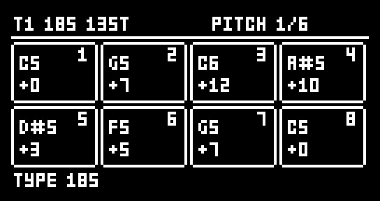
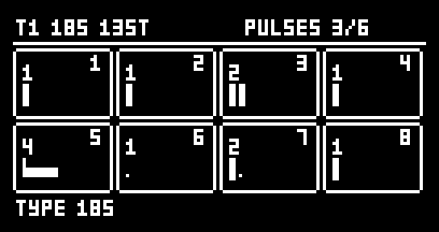
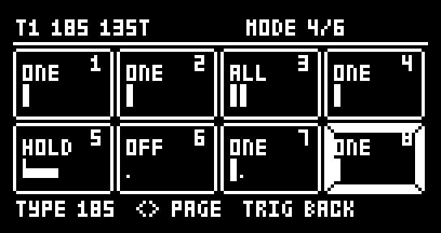
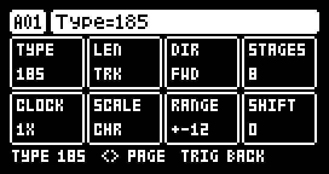
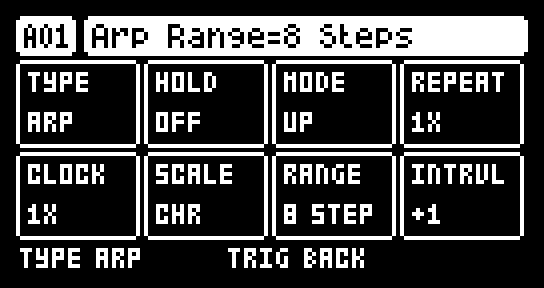
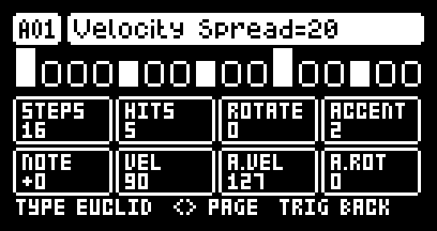
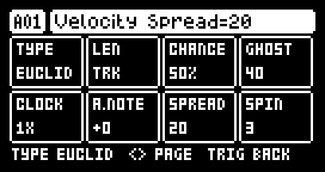
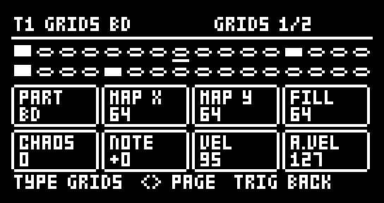
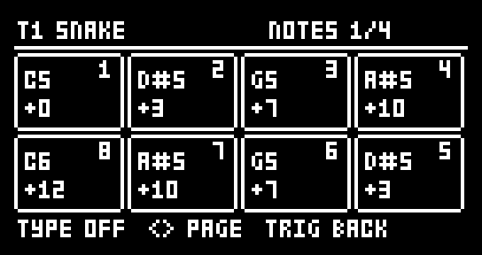
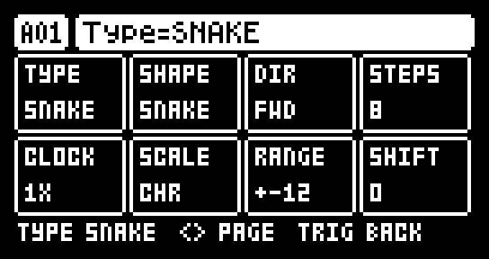

# DIGISEQ for Digitakt

**This is the Digitakt version.** For the Elektron Digitone mk1 / Digitone Keys, use
[DIGISEQ for Digitone](https://github.com/ClaidArremer/digitone-digiseq) instead: the files here do not run on a
Digitone, and the Digitone's do not run on a Digitakt.

Sequencer types for the **Elektron Digitakt mk1**, as an [elekloader](https://github.com/irpina/elekloader) mod
(id `digiseq-dt`). Each track picks its own **TYPE** and plays it in place of its own trigs, so T1 can play
SNAKE, T2 185, T3 ARP, and T4 its own trigs. It works on all 8 audio tracks (a note is the sample's pitch, like a note
lock) and the 8 MIDI tracks, for external gear.

- **SNAKE**: a Cartesian sequencer after Maxime Dangles' MDD Snake and Make Noise's René. Eight cells in a
  4 × 2 grid that matches knobs A–H, walked by a path. This is
  [DIGISNAKE for Digitakt](https://github.com/ClaidArremer/digitakt-digisnake), unchanged.
- **185**: a stage sequencer after **ML-185** (Nico Starke's free Max for Live device, itself after RYK's
  M-185 for the Roland System 100m). Eight stages, each with a pitch, a velocity, a **length of 1–8 clock
  pulses** (how long the stage plays before the next) and a **mode**: rest, one note, a note every pulse, or
  one note held for the whole stage.
- **ARP**: an arpeggiator, played by the keys you hold in keyboard mode (FUNC + TRK, audio tracks, HOLD to
  latch) or by the track's own note trigs, and recorded live into the track with REC + PLAY. The notes held are
  arpeggiated over up to 8 octaves, or (INTRVL) up to 8 neighbouring notes. In
  slice mode a note is a slice, so ARP arpeggiates slices: with INTRVL +1 it steps through a sample chain's slices;
  on a single-cycle waveform it plays like a synth's arp. **ARP is for the Digitakt only**: the Digitone has its own arpeggiator, so DIGISEQ for Digitone has no
  ARP type.
- **EUCLID** (0.9): a Euclidean rhythm. HITS spread as evenly as they go over STEPS (1–16), turned by ROTATE, with
  some of the hits accented, spread evenly among them in turn.
- **TURING** (0.10): after the Music Thing **Turing Machine**. A loop of up to 16 bits plays notes, rests and
  velocities, and each bit may flip as it comes round: from a locked loop to a melody that slowly changes.
- **GRIDS** (0.11): after Mutable Instruments **Grids**. The track plays one part (kick, snare or hat) of Grids'
  map of drum patterns, from a place you choose on the map, as busy as you like.

Every type works on its own track: nothing a track plays depends on another track.

By Robbie (designed and tested on a Digitakt mk1, OS 1.54). GPL-3.0-or-later (see Licence).

> Unofficial and unsupported. Flashing modified firmware is at your own risk; the stock Digitakt OS always
> recovers the unit (send the stock .syx from the boot menu).

| 185: NOTES | 185: PULSES |
|---|---|
|  |  |
| **185: MODE** (playing) | **185: SETUP** |
|  |  |
| **ARP** | **EUCLID: EUCLID** |
|  |  |
| **EUCLID: SETUP** | **GRIDS: GRIDS** (playing) |
|  |  |
| **SNAKE: NOTES** | **SNAKE: SETUP** |
|  |  |

The pages as DIGISEQ draws them on the Digitakt (the whole screen: the title line on top, hints on the bottom
line). Messages show in the stock drop-down over the title line, as on the other pages (*Type=ARP*,
*Arp Mode=UP-DN*).

## What you need

| | |
|---|---|
| Unit | **Digitakt mk1** (not the Digitakt II) |
| OS | **1.54**. A 1.53 build is included (run in an emulator, not on a unit) |
| Mods | elekloader's Digitakt **core** (3.0 or later; the app's own is fine, or the core 4.1 that [PUMP for Digitakt](https://github.com/ClaidArremer/digitakt-pump) needs), and **seq-events 0.2** for the Digitakt, included here in `elemods/` |
| Not with | **DIGISNAKE for Digitakt**: DIGISEQ replaces it (SNAKE is one of its types) |

seq-events 0.2 is elekloader's seq-events with one new event, `ev_fire_len`, which lets a mod set the length
of the note a step plays. 185's held stages need it. Mods built for seq-events 0.1 work with 0.2.

## Install

In the elekloader app, add both files for your OS from `elemods/`: `digiseq-dt-0.12-os1.54.elemod` and
`seq-events-dt-0.2-os1.54.elemod` (or the two `-os1.53` files). Untick DIGISNAKE and any older seq-events, keep
the app's core ticked, build, and send the firmware to the Digitakt. From the command line:

```
python -m elekloader.patch --stock Digitakt_OS1.54.syx \
  --mod core-4.1-os1.54.elemod --mod elemods/seq-events-dt-0.2-os1.54.elemod \
  --mod elemods/digiseq-dt-0.12-os1.54.elemod --out Digitakt_digiseq.syx
```

It links with PUMP for Digitakt 1.3, DH-101 0.25, Digi Mono 0.24, machine-pages 1.3, digihealth 1.0.1, the
LØST LVLS boot splash and DIRECT JUMP for Digitakt 1.0.

## Opening it and choosing a type

Press **TRIG** twice: the first press shows the Digitakt's TRIG page, the second opens DIGISEQ (however long it
is held). TRIG again goes back to the TRIG page; another page key goes to its page, and a menu opening over the
pages (GLOBAL, the pattern menu ...) closes it. **FUNC + TRIG** is the stock's, as ever: the QUANTIZE menu.

The last page's knob A is **TYPE**: **OFF**, **SNAKE**, **185**, **ARP**, **EUCLID**, **TURING** or **GRIDS**. Hold **TRIG + UP / DOWN** to step through
the types from any page. With a type on, the track plays it in place of its own trigs; lock trigs still play,
and trig conditions or probabilities on the track's own trigs do not stop a step the type plays. With TYPE OFF
the page shows TYPE alone, on knob A (0.12); every type keeps its settings while it is off.

Every type's settings page follows SNAKE's SETUP page (0.11 and before: PATH) (0.12): **A** is TYPE, **B** the note length or its
nearest, **C** the direction or mode, **E** the clock (CLOCK), **F** SCALE, **G** RANGE and
**H** SHIFT or its nearest.

**Nothing is saved with the project.** The Digitakt's core has no project storage yet: the types and their
settings reset on power-off and project load. **PRINT** keeps a sequence (it writes it into the track's trigs),
and so does **live recording**.

## Recording live (every type)

Live recording (**REC + PLAY**) records what a track's type plays, step by step as it plays: each note goes onto
its step as a note trig (its note as the note lock, its velocity, no micro timing and no condition; 185's held
and LEN-set notes with their LEN, the others the track's LEN), over a trig already on that step. The steps the type
does not play keep what they had. Change anything while it records (SNAKE's CLOCK, its SHAPE or DIR, 185's
stages, the notes) and what you hear is what goes into the track.

When the recording stops (REC off, or STOP), **TYPE goes to OFF** on each track it recorded into, so the trigs
play back as recorded. A track recorded at **2X** keeps its doubled speed, as PRINT does, so it plays back at the
speed it was recorded at. 2X runs the whole track at twice its speed, so switch it on or off before a take, not
during one: notes recorded at the other speed would play back at the wrong time.

## 185

The sequence plays the stages in turn. Each stage lasts its **PULSES** in clock pulses (a pulse is a step at
CLOCK 1X), then the next stage starts. What a stage plays depends on its **MODE**:

| MODE | What the stage plays |
|---|---|
| OFF | Nothing: a rest as long as the stage |
| ONE | One note on the stage's first pulse |
| ALL | A note on every pulse, or with DIV 2–4 every 2nd, 3rd or 4th pulse |
| HOLD | One note on the first pulse, held for the whole stage |

Each stage box shows its pulses as a row of slots: a tall tick is a note, a dot a silent pulse, a bar a held
note, and the line underneath the pulse playing. Knobs A–H are stages 1–8.

| Page | Knobs A–H | Also |
|---|---|---|
| NOTES | Each stage's note, −24 to +24 semitones from the track's NOTE, quantised to SCALE | UP / DOWN: all a semitone (FUNC: an octave). FUNC + knob: −24 / −12 / 0 / +12 / +24 |
| VELOCITY | Each stage's velocity, 1–127 | UP / DOWN: all up or down. FUNC + knob: 1 / 32 / 64 / 96 / 127 |
| PULSES | Each stage's length, 1–8 pulses | UP / DOWN: all one longer or shorter |
| MODE | Each stage's mode | Trig keys 1–8: that stage's next mode (hold TRK to select tracks as usual). UP / DOWN: rotate the modes |
| DIV | ALL's division, 1–4 | UP / DOWN: all |
| SETUP | The settings below | |

| Knob | SETUP | Values |
|---|---|---|
| A | TYPE | OFF and the types |
| B | LEN | The length of ONE and ALL notes: TRK (the track's LEN), 1/32, 1/16, 1/8, 1/4. HOLD notes always last their stage |
| C | DIR | FWD, BWD, F/B, B/F, RND |
| D | STAGES | How many stages the sequence plays, 1–8 |
| E | CLOCK | 1/8, 1/4, 1/2, 1X, 2X: steps a pulse. 2X runs the track at twice its own speed and needs the pattern in per-track SCALE mode (FUNC + PAGE) |
| F | SCALE | CHR, MAJ, MIN, DOR, PHR, LYD, MIX, HMIN, PENT, mPNT, BLUE, WHOL, rooted on the track's NOTE (the Digitakt has no keyboard ROOT) |
| G | RANGE | The spread of randomised pitches, ±1–24 semitones |
| H | SHIFT | Which stage the sequence starts on, 0–7 |

The title line shows the sequence's length in steps (13ST: 13 steps), which may not match the pattern's.

## ARP

ARP plays from the keys you hold in keyboard mode, and from the track's own note trigs.

### From the keys (keyboard mode)

On an audio track with TYPE ARP, turn the keyboard on (**FUNC + TRK**) and press **PLAY**: the keys you hold are
the arp's notes, in whatever KB SCALE, ROOT, FOLD and octave the keyboard is set to (up to 8 at once; a 9th lets go
of the oldest). The arp starts on the next step after the first key goes down and keeps time with the sequencer, at
CLOCK. While keys hold notes they play the arp in place of the track's trigs; let go of them all and the trigs play
again. Every arp note plays at the keyboard's velocity.

- **HOLD on** latches: the notes stay when you let go. The next key pressed with none held starts a new set; keys
  added while others are held join it. HOLD off lets go of the latched notes.
- **Stopped**, a key plays its note as usual (no arp: the arp keeps time with the sequencer) and is still held for
  the arp, so with HOLD on you can latch a set and then press PLAY.
- The title line shows **KB** and how many notes are held (T1 ARP KB3).

### Recording it

Live recording (**REC + PLAY**) on an ARP track records what the arp plays from the keys: each arp note goes onto its
step as a note trig, with the note as its note lock, the keyboard's velocity and the track's LEN, no micro timing and no condition. It records over a trig already on that step; the steps the arp does not play
keep what they had. While recording with no key held, the track's trigs play as they are stored (no arp), so you hear
what you have recorded so far.

When the recording stops (REC off, or STOP), **TYPE goes to OFF** on each track it recorded into, so the notes play
back as recorded. Turn TYPE back to ARP to play the arp again (the trigs you recorded would then start it, as any
trigs do). Grid recording (REC alone) is unchanged: trig keys place trigs as usual.

### From the trigs

The track's own note trigs work like keys held down. Put a trig where the arp should start and give it
a LEN (the TRIG page's LEN, or the track's): the trig's note is held that long and the arp plays it at CLOCK, the
trig's own step playing the first note. A new trig starts it again with its note. With **HOLD** on, a trig's
note is held until the next trig (or STOP), whatever its LEN; a LEN of INF does the same.

- **Audio tracks**: the trig's note (its note lock, else the track's NOTE) is arpeggiated over RANGE octaves (or
  RANGE steps of INTRVL). In slice mode, where a note is a slice, this steps through slices: an octave is 12 slices
  on, and INTRVL +1 plays the next slices of a chain.
- **MIDI tracks**: the trig's whole chord (the note and its intervals) is the notes held.
- **Velocity**: every arp note plays the trig's velocity.
- **Trig conditions and probability** on a trig decide whether that trig starts the arp, as they decide whether
  it plays. The arp's own notes always play.
- **Locks**: a trig's parameter locks belong to its own step; the arp's later notes play without them.

ARP has one page (0.12), its knobs laid out as SNAKE's SETUP page:

| Knob | ARP | Values |
|---|---|---|
| A | TYPE | OFF and the types |
| B | HOLD | OFF: a trig's note is held for its LEN. ON: until the next trig |
| C | MODE | UP, DOWN, UP-DN (the ends once), UP+DN (the ends twice), CONV (outside in), DIV (inside out), PINKY (each note, then the top), THUMB (the bottom, then each note), ORDER (as played: a MIDI chord's order), RAND, SHUF (each note once a cycle, in a new order each cycle) |
| D | REPEAT | Each note played 1–4 times before the next |
| E | CLOCK | 1X, 1/2, 1/3, 1/4, 1/8, 1/16: a note every 1, 2, 3, 4, 8 or 16 steps (at the track's speed). Turn right for faster, as the other types' CLOCK (0.11 and before: SPD, 1/16 to 1/1) |
| F | SCALE | CHR (none), MAJ, MIN, DOR, PHR, LYD, MIX, HMIN, PENT, mPNT, BLUE, WHOL, rooted on the track's NOTE: every arp note is moved down to the scale's nearest note |
| G | RANGE | How many copies of the notes the arp climbs through, 1–8: octaves (INTRVL OCT), or steps of INTRVL |
| H | INTRVL | The interval between those copies: OCT (12 semitones, as before) or +1 to +11. For a **sample chain** on a slice track, INTRVL +1 and RANGE 8 plays the trig's slice and the 7 after it, in MODE's order: UP walks the chain, RAND and SHUF shuffle the hits, UP-DN rocks back and forth. INTRVL +2 takes every other slice |

ARP's notes come from the sequencer's steps, so CLOCK is 1X (a note a step) at the fastest, and there are no triplet speeds. ARP
does not run from incoming MIDI notes: only from the keyboard and the track's trigs.

**PRINT** does nothing on an ARP track ("PRINT N/A FOR ARP"): record it live instead (above).

## EUCLID

Two pages: **EUCLID** and **SETUP**.

**EUCLID** shows the pattern as a row of steps over the trig keys: a hit a filled bar, an accented hit a taller
one, a rest a frame, the steps past STEPS dots, and the step playing underlined (while it plays, turned as SPIN
turns it). Its knobs, in boxes under the steps:

| Knob | | |
|---|---|---|
| A | **STEPS** | The pattern's length, 1–16 steps (it runs against the track's own length: 5 against 16 makes a polymeter) |
| B | **HITS** | How many of the steps play, spread as evenly as they go |
| C | **ROTATE** | Turns the pattern round, a step at a time |
| D | **ACCENT** | How many of the hits are accented, spread evenly among them |
| E | **NOTE** | ± semitones from the track's NOTE |
| F | **VEL** | The hits' velocity |
| G | **A.VEL** | The accented hits' velocity |
| H | **A.ROT** | Turns which hits are accented |

**SETUP** (laid out as SNAKE's SETUP page; C, D, G and H new in 0.12):

| Knob | | |
|---|---|---|
| A | **TYPE** | |
| B | **LEN** | TRK (the track's LEN), or 1/32 to 1/4 |
| C | **CHANCE** | The chance each hit plays, 0–100%. A hit that doesn't is a rest (and plays a ghost note, with GHOST on) |
| D | **GHOST** | Ghost notes: OFF, or a velocity (1–127) for a quiet note on every rest. FUNC + knob: OFF / 16 / 32 / 48 / 64 |
| E | **CLOCK** | 1/8, 1/4, 1/2, 1X or 2X, as SNAKE's and 185's CLOCK |
| F | **A.NOTE** | ± semitones an accented hit plays above or below NOTE: +12 plays the accents an octave up |
| G | **SPREAD** | Velocity spread: each note plays up to this much below its velocity, at random |
| H | **SPIN** | Each time round, the pattern turns this many more steps (0: it stays put). It starts again from ROTATE at a pattern start |

On the EUCLID page a **trig key** sets STEPS, **FUNC + a trig key** sets HITS, and **UP / DOWN** turn the pattern.

## TURING

After Tom Whitwell's Music Thing Modular **Turing Machine**. A 16-bit shift register loops over its last
**STEPS** bits. Each clock pulse the bit coming round goes back in at the start, and **CHANGE** is the chance it flips
on the way: at 0% the loop is locked and repeats exactly, at 50% it never repeats, and between them it changes
a little at a time; at 100% every bit flips, so the loop plays twice as long, its second half inverted. The
register runs on through pattern starts, as the module does. Its bits 0–7 are the note, bits 4–11 decide whether
the step plays and bits 8–15 its velocity.

Two pages: **TURING** and **SETUP**. TURING shows the loop as a row of STEPS bits (1 filled, 0 a frame, the bit
coming round next underlined), with the note the register plays now (or REST) on the title line. Its knobs, in
boxes under the bits:

| Knob | | |
|---|---|---|
| A | **STEPS** | The loop, 2–16 steps |
| B | **CHANGE** | The chance a bit flips as it comes round, 0–100% |
| C | **RANGE** | How far the notes go above NOTE, 1–48 semitones |
| D | **SCALE** | CHR or one of 11 scales, rooted on the track's NOTE |
| E | **FILL** | How many of the steps play, 0–100% |
| F | **NOTE** | ± semitones from the track's NOTE: the lowest note |
| G | **VEL** | The loudest velocity |
| H | **SPREAD** | How far below VEL the register takes the velocity |

**SETUP**: **TYPE** (A), **LEN** (B) and **CLOCK** (E), as EUCLID's.

On the TURING page a **trig key** sets STEPS, **FUNC + a trig key** flips that bit, and **UP / DOWN** turn the loop a
step. PAGE + YES writes a new random register.

## GRIDS

After Émilie Gillet's Mutable Instruments **Grids**, with its map of drum patterns. The map is 5 × 5 patterns of 32
steps, each with a kick, a snare and a hat part; every step has a level, and a place between the patterns blends
the patterns round it. The track plays one **PART** of the pattern at the place **MAP X**, **MAP Y**: a step plays when its
level is above what **FILL** lets through, so FILL takes the part from its strongest hits to every step. A step
with a high level is accented. Each track has its own place on the map: put three tracks on GRIDS with the kick,
snare and hat parts and the same X and Y to play Grids' whole pattern.

Two pages: **GRIDS** and **SETUP**. GRIDS shows the part's 32 steps as EUCLID shows its steps (0.12), in two rows
over the trig keys: steps 1–16 on top, 17–32 under them; a hit filled, an accent taller, a rest a frame, the step
playing underlined. Its knobs, in boxes under the steps:

| Knob | | |
|---|---|---|
| A | **PART** | BD, SD or HH: which part of the pattern the track plays |
| B | **MAP X** | The place on the map, 0–127 |
| C | **MAP Y** | |
| D | **FILL** | How many of the steps play, from the strongest |
| E | **CHAOS** | Adds a random amount to the levels, new each time round the 32 steps |
| F | **NOTE** | ± semitones from the track's NOTE |
| G | **VEL** | The hits' velocity |
| H | **A.VEL** | The accented hits' velocity |

**SETUP**: **TYPE** (A), **LEN** (B) and **CLOCK** (E), as EUCLID's. At 1X a step a sixteenth, the 32 steps are two bars.

On the GRIDS page **trig keys 1–3** pick the part (BD, SD, HH) and **UP / DOWN** change FILL.

## SNAKE

As DIGISNAKE for Digitakt: NOTES, GATES (trig keys 1–8 toggle a cell), VELOCITY and SETUP (TYPE, SHAPE, DIR,
STEPS, CLOCK, SCALE, RANGE, SHIFT; until 0.12 called PATH, with LEN and DIV). SETUP's knob A is TYPE instead of SNAKE on/off.

## Keys

PAGE is the TRIG key, held.

| Keys | What happens |
|---|---|
| PAGE + UP / DOWN | The next / previous TYPE |
| PAGE + YES | Randomise the page shown (SNAKE's SETUP: all but TYPE and SCALE; 185's SETUP: DIR, STAGES, RANGE and SHIFT; ARP: MODE, CLOCK, RANGE and REPEAT; EUCLID: STEPS, HITS, ROTATE and the accents; TURING: a new register; GRIDS: a new place on the map; their SETUP: CLOCK, and EUCLID's A.NOTE) |
| PAGE + NO | Back to how the track was when PAGE went down, a print included |
| PAGE + PLAY | Clear the page shown |
| PAGE + REC | Copy the page shown |
| PAGE + STOP | Paste it onto this track (only onto a track of the same type) |
| PAGE + FUNC + REC | **Print** (not on an ARP track): write what the track plays into its own trigs, note locks and velocities over the track's length (185: held and LEN-set notes as LEN locks), then set TYPE to OFF |
| FUNC + YES | Randomise the note pages together (SNAKE: NOTES, GATES, VELOCITY; 185: NOTES, VELOCITY, PULSES, MODE; ARP: as PAGE + YES; EUCLID, TURING and GRIDS: as PAGE + YES on their first page) |
| FUNC + NO | Back to before the last run of FUNC + YES |
| FUNC + knob | Jump to preset values (pitches, velocities, RANGE), or in bigger steps (TURING's CHANGE and FILL by 10, GRIDS' MAP X, MAP Y, FILL and CHAOS by 8) |

## With DIRECT JUMP

With [DIRECT JUMP for Digitakt](https://github.com/ClaidArremer/digitakt-directjump) 1.0 in the build, a pattern started by its START ON BAR starts every track's
sequence from the beginning too, every type alike (TURING's register runs on, as it does through any pattern
start). A legato jump leaves them playing on.

## Changes

See [CHANGELOG.md](CHANGELOG.md).

## How it works

DIGISEQ uses seq-events' step-fire events: `ev_gen_trig` decides whether a step fires, `ev_gen_notes` its note,
`ev_fire_vel` its velocity, `ev_fire_len` its length and `ev_fire_cond` lets a step it plays through a stored
trig's condition (ARP leaves a note trig's condition to decide, and starts in `ev_gen_notes`, which runs only for a
step that plays). A HOLD sets its note's LEN to the stage's length in steps (the Digitakt's LEN values are the
Digitone's: index 14 is one step, 30 two, 46 four, 62 eight). The page reads the key dispatcher's screens to
know when the TRIG page is up and draws over it. PRINT and 2X write the active pattern: 911 bytes a track, its
step words at +0, each step's VEL at +0x80 and LEN at +0xc0, note lock 1 at +0x280, the track's speed at
+0x38b; the pattern pointer and the transport are the per-OS addresses seq-events uses (`mod.json`'s cflags).

`ev_fire_len` is new in seq-events 0.2: two code sites on the Digitakt, one in each step fire (the audio
tracks' and the MIDI tracks'), where the fire reads a step's LEN (its lock at +0xc0, else the track's at
+0x381). The change to elekloader's source is in `seq-events/ev_fire_len.patch` (the Digitone's and the
Digitakt's).

The keyboard: two code sites (`kbsites.s`), the same in OS 1.53 and 1.54. The keyboard plays a key's note through
one routine, `0x4002930e` (it is handed the key, the track, the note and the velocity), and lets the key go through
another, `0x40028c78`. DIGISEQ enters each by a jmp over its first instructions: on an ARP track it keeps the key's
note for the arp (and, while playing, returns before the stock note plays); otherwise the routine runs as stock. Live recording: the keyboard's controller (the routine's first argument) keeps
the sequencer's state at +152, where +353 is REC and +361 live recording; ARP writes each recorded note on its step
(note lock +0x280, velocity +0x80, LEN +0xc0, micro timing +0x100 cleared, condition +0x200 none).

## Building

With elekloader (with the seq-events patch applied) and an m68k cross GCC on the path:

```
python -m elekloader.sdk.build --stock Digitakt_OS1.54.syx .
```

## Credits and third-party code

DIGISEQ is Robbie's own work, written with Claude (Anthropic); every line of `digiseq_dt.c` and `kbsites.s` is new. The ideas
come from **MDD Snake** (Maxime Dangles' free Max for Live device), **Make Noise René**, **ML-185** (Nico
Starke's free Max for Live device), **RYK's M-185** and Tom Whitwell's **Music Thing Modular Turing Machine**; no
code from any of them. EUCLID's patterns are the even spreads of Godfried Toussaint's *The Euclidean Algorithm
Generates Traditional Musical Rhythms* (2005), worked out in a line of new code. The random numbers use
Marsaglia's xorshift, a public algorithm.

**GRIDS' map** (`grids_map.h`) is the drum pattern map of **Mutable Instruments Grids**, by Émilie Gillet, from
`grids/resources.cc` of [pichenettes/eurorack](https://github.com/pichenettes/eurorack), Copyright 2012 Émilie
Gillet, under the **GNU General Public License, version 3 or later**. The data is unchanged; only its layout as one
C array is new. How a step's level is read from the map (the blend between its patterns, FILL's threshold, the
accent and CHAOS) follows Grids' `pattern_generator.cc`, rewritten.

It builds against irpina's [elekloader](https://github.com/irpina/elekloader) SDK headers and runs on its
Digitakt core and seq-events (GPL-2.0-or-later). The core is not included here. seq-events is: the two
`elemods/seq-events-dt-0.2-*.elemod` files are builds of elekloader's `mods/seq-events-dt1` (GPL-2.0-or-later,
by elekloader's contributors) from
[its source at commit b9006bf](https://github.com/irpina/elekloader/tree/b9006bf8b7c4e69becd7e2f16ec6b20ea52b8982/mods/seq-events-dt1)
with `seq-events/ev_fire_len.patch` applied. They carry only that mod's own code and no Elektron code. The
firmware addresses in `mod.json` and the patch, and the pattern layout DIGISEQ prints into, were found by
studying the Digitakt's own OS so the mod can work with it; no Elektron code is included.

## Trademarks

Elektron, Digitakt and Digitone are trademarks of Elektron Music Machines; Make Noise and René of Make Noise;
Roland and System 100m of Roland Corporation; Max for Live of Ableton AG and Cycling '74. They are named only
to say what this works with or was inspired by. This project is not affiliated with or endorsed by any of them.

## Licence

DIGISEQ's own code is GPL-2.0-or-later. From 0.11 it includes Grids' map, which is GPL-3.0-or-later, so DIGISEQ as a
whole (and the .elemod files from 0.11 on) is **GPL-3.0-or-later**. See [LICENSE](LICENSE).
