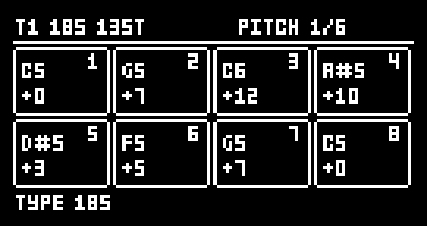
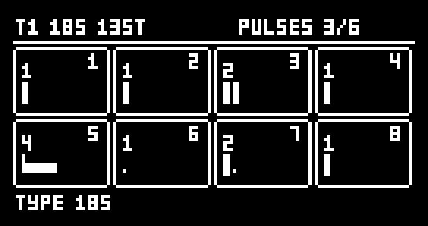
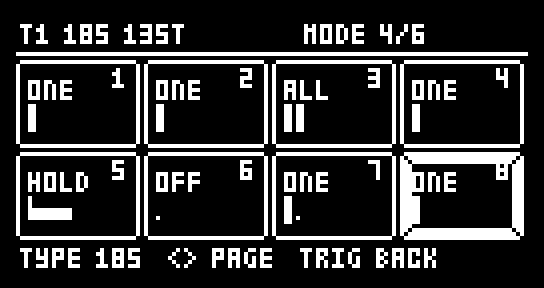
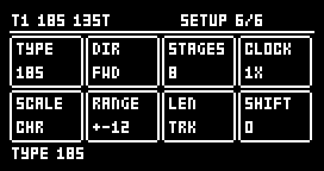
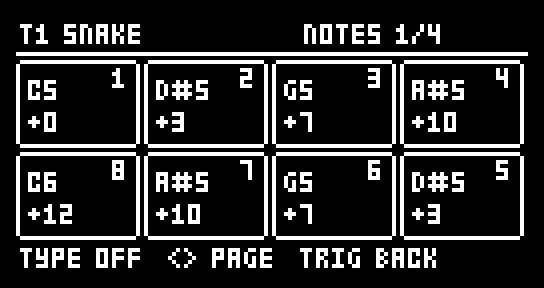
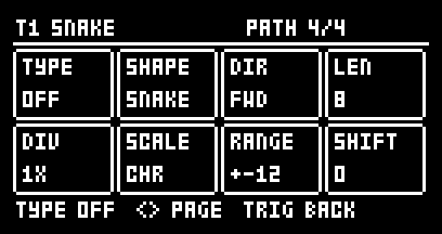

# DIGISEQ for Digitakt

**This is the Digitakt version.** For the Elektron Digitone mk1 / Digitone Keys, use
[DIGISEQ for Digitone](https://github.com/ClaidArremer/digitone-digiseq) instead: the files here do not run on a
Digitone, and the Digitone's do not run on a Digitakt.

Sequencer types for the **Elektron Digitakt mk1**, as an [elekloader](https://github.com/irpina/elekloader) mod
(id `digiseq-dt`). Each track picks its own **TYPE** and plays it in place of its own trigs, so T1 can play
SNAKE, T2 185, and T3 its own trigs. It works on all 8 audio tracks (a note is the sample's pitch, like a note
lock) and the 8 MIDI tracks, for external gear.

- **SNAKE**: a Cartesian sequencer after Maxime Dangles' MDD Snake and Make Noise's René. Eight cells in a
  4 × 2 grid that matches knobs A–H, walked by a path. This is
  [DIGISNAKE for Digitakt](https://github.com/ClaidArremer/digitakt-digisnake), unchanged.
- **185**: a stage sequencer after **ML-185** (Nico Starke's free Max for Live device, itself after RYK's
  M-185 for the Roland System 100m). Eight stages, each with a pitch, a velocity, a **length of 1–8 clock
  pulses** (how long the stage plays before the next) and a **mode**: rest, one note, a note every pulse, or
  one note held for the whole stage.

By Robbie (designed and tested on a Digitakt mk1, OS 1.54). GPL-2.0-or-later.

> Unofficial and unsupported. Flashing modified firmware is at your own risk; the stock Digitakt OS always
> recovers the unit (send the stock .syx from the boot menu).

| 185: PITCH | 185: PULSES |
|---|---|
|  |  |
| **185: MODE** (playing) | **185: SETUP** |
|  |  |
| **SNAKE: NOTES** | **SNAKE: PATH** |
|  |  |

The pages as DIGISEQ draws them on the Digitakt (the whole screen: the title line on top, messages on the
bottom line).

## What you need

| | |
|---|---|
| Unit | **Digitakt mk1** (not the Digitakt II) |
| OS | **1.54**. A 1.53 build is included (run in an emulator, not on a unit) |
| Mods | elekloader's Digitakt **core** (3.0 or later; the app's own is fine, or the core 4.1 that [PUMP for Digitakt](https://github.com/ClaidArremer/digitakt-pump) needs), and **seq-events 0.2** for the Digitakt, included here in `elemods/` |
| Not with | **DIGISNAKE for Digitakt**: DIGISEQ replaces it (SNAKE is one of its types) |

seq-events 0.2 is elekloader's seq-events with one new event, `ev_fire_len`, which lets a mod set the length
of the note a step plays. 185's held stages need it. Mods built for seq-events 0.1 work with 0.2.

## Install

In the elekloader app, add both files for your OS from `elemods/`: `digiseq-dt-0.2-os1.54.elemod` and
`seq-events-dt-0.2-os1.54.elemod` (or the two `-os1.53` files). Untick DIGISNAKE and any older seq-events, keep
the app's core ticked, build, and send the firmware to the Digitakt. From the command line:

```
python -m elekloader.patch --stock Digitakt_OS1.54.syx \
  --mod core-4.1-os1.54.elemod --mod elemods/seq-events-dt-0.2-os1.54.elemod \
  --mod elemods/digiseq-dt-0.2-os1.54.elemod --out Digitakt_digiseq.syx
```

It links with PUMP for Digitakt 1.3, DH-101 0.25, Digi Mono 0.24, machine-pages 1.3, digihealth 1.0.1, the
LØST LVLS boot splash and DIRECT JUMP for Digitakt 1.0.

## Opening it and choosing a type

Press **TRIG** twice: the first press shows the Digitakt's TRIG page, the second opens DIGISEQ (however long it
is held). TRIG again goes back to the TRIG page; another page key goes to its page, and a menu opening over the
pages (GLOBAL, the pattern menu ...) closes it.

The last page's knob A is **TYPE**: **OFF**, **SNAKE** or **185**. Hold **TRIG + UP / DOWN** to step through
the types from any page. With a type on, the track plays it in place of its own trigs; lock trigs still play,
and trig conditions or probabilities on the track's own trigs do not stop a step the type plays. OFF keeps
every type's settings, so the pages still show and edit the last type.

**Nothing is saved with the project.** The Digitakt's core has no project storage yet: the types and their
settings reset on power-off and project load. **PRINT** keeps a sequence (it writes it into the track's trigs).

## 185

The sequence plays the stages in turn. Each stage lasts its **PULSES** in clock pulses (a pulse is a step at
CLOCK 1X), then the next stage starts. What a stage plays depends on its **MODE**:

| MODE | What the stage plays |
|---|---|
| OFF | Nothing: a rest as long as the stage |
| ONE | One note on the stage's first pulse |
| ALL | A note on every pulse, or with DIV 2–4 every 2nd, 3rd or 4th pulse |
| HOLD | One note on the first pulse, held for the whole stage |

Each stage box shows its pulses as a row of slots: a tall tick is a note, a dot a silent pulse, a bar a held
note, and the line underneath the pulse playing. Knobs A–H are stages 1–8.

| Page | Knobs A–H | Also |
|---|---|---|
| PITCH | Each stage's note, −24 to +24 semitones from the track's NOTE, quantised to SCALE | UP / DOWN: all a semitone (FUNC: an octave). FUNC + knob: −24 / −12 / 0 / +12 / +24 |
| VELOCITY | Each stage's velocity, 1–127 | UP / DOWN: all up or down. FUNC + knob: 1 / 32 / 64 / 96 / 127 |
| PULSES | Each stage's length, 1–8 pulses | UP / DOWN: all one longer or shorter |
| MODE | Each stage's mode | Trig keys 1–8: that stage's next mode (hold TRK to select tracks as usual). UP / DOWN: rotate the modes |
| DIV | ALL's division, 1–4 | UP / DOWN: all |
| SETUP | The settings below | |

| Knob | SETUP | Values |
|---|---|---|
| A | TYPE | OFF, SNAKE, 185 |
| B | DIR | FWD, BWD, F/B, B/F, RND |
| C | STAGES | How many stages the sequence plays, 1–8 |
| D | CLOCK | 1/8, 1/4, 1/2, 1X, 2X: steps a pulse. 2X runs the track at twice its own speed and needs the pattern in per-track SCALE mode (FUNC + PAGE) |
| E | SCALE | CHR, MAJ, MIN, DOR, PHR, LYD, MIX, HMIN, PENT, mPNT, BLUE, WHOL, rooted on the track's NOTE (the Digitakt has no keyboard ROOT) |
| F | RANGE | The spread of randomised pitches, ±1–24 semitones |
| G | LEN | The length of ONE and ALL notes: TRK (the track's LEN), 1/32, 1/16, 1/8, 1/4. HOLD notes always last their stage |
| H | SHIFT | Which stage the sequence starts on, 0–7 |

The title line shows the sequence's length in steps (13ST: 13 steps), which may not match the pattern's.

## SNAKE

As DIGISNAKE for Digitakt: NOTES, GATES (trig keys 1–8 toggle a cell), VELOCITY and PATH (TYPE, SHAPE, DIR,
LEN, DIV, SCALE, RANGE, SHIFT). PATH's knob A is TYPE instead of SNAKE on/off.

## Keys

PAGE is the TRIG key, held.

| Keys | What happens |
|---|---|
| PAGE + UP / DOWN | The next / previous TYPE |
| PAGE + YES | Randomise the page shown (SNAKE's PATH: all but TYPE and SCALE; 185's SETUP: DIR, STAGES, RANGE and SHIFT) |
| PAGE + NO | Back to how the track was when PAGE went down, a print included |
| PAGE + PLAY | Clear the page shown |
| PAGE + REC | Copy the page shown |
| PAGE + STOP | Paste it onto this track (only onto a track of the same type) |
| PAGE + FUNC + REC | **Print**: write what the track plays into its own trigs, note locks and velocities over the track's length (185: held and LEN-set notes as LEN locks), then set TYPE to OFF |
| FUNC + YES | Randomise the note pages together (SNAKE: NOTES, GATES, VELOCITY; 185: PITCH, VELOCITY, PULSES, MODE) |
| FUNC + NO | Back to before the last run of FUNC + YES |
| FUNC + knob | Jump to preset values (pitches, velocities, RANGE) |

## With DIRECT JUMP

With DIRECT JUMP for Digitakt 1.0 in the build, a pattern started by its START ON BAR starts every track's
sequence from the beginning too, SNAKE and 185 alike. A legato jump leaves them playing on.

## Changes

- **0.2**: PRINT puts each printed note on its step with no trig condition, so a trig left there from before
  can no longer shift it (micro timing) or mute it on some loops (a condition such as 1:2).
- **0.1**: the first version: SNAKE (from DIGISNAKE for Digitakt 0.3) and 185.

## How it works

DIGISEQ uses seq-events' step-fire events: `ev_gen_trig` decides whether a step fires, `ev_gen_notes` its note,
`ev_fire_vel` its velocity, `ev_fire_len` its length and `ev_fire_cond` lets a step it plays through a stored
trig's condition. A HOLD sets its note's LEN to the stage's length in steps (the Digitakt's LEN values are the
Digitone's: index 14 is one step, 30 two, 46 four, 62 eight). The page reads the key dispatcher's screens to
know when the TRIG page is up and draws over it. PRINT and 2X write the active pattern: 911 bytes a track, its
step words at +0, each step's VEL at +0x80 and LEN at +0xc0, note lock 1 at +0x280, the track's speed at
+0x38b; the pattern pointer and the transport are the per-OS addresses seq-events uses (`mod.json`'s cflags).

`ev_fire_len` is new in seq-events 0.2: two code sites on the Digitakt, one in each step fire (the audio
tracks' and the MIDI tracks'), where the fire reads a step's LEN (its lock at +0xc0, else the track's at
+0x381). The change to elekloader's source is in `seq-events/ev_fire_len.patch` (the Digitone's and the
Digitakt's).

## Building

With elekloader (with the seq-events patch applied) and an m68k cross GCC on the path:

```
python -m elekloader.sdk.build --stock Digitakt_OS1.54.syx .
```

## Credits and third-party code

DIGISEQ is Robbie's own work, written with Claude (Anthropic); every line of `digiseq_dt.c` is new. The ideas
come from **MDD Snake** (Maxime Dangles' free Max for Live device), **Make Noise René**, **ML-185** (Nico
Starke's free Max for Live device) and **RYK's M-185**; no code from any of them. The random numbers use
Marsaglia's xorshift, a public algorithm.

It builds against irpina's [elekloader](https://github.com/irpina/elekloader) SDK headers and runs on its
Digitakt core and seq-events (GPL-2.0-or-later). The core is not included here. seq-events is: the two
`elemods/seq-events-dt-0.2-*.elemod` files are builds of elekloader's `mods/seq-events-dt1` (GPL-2.0-or-later,
by elekloader's contributors) from
[its source at commit b9006bf](https://github.com/irpina/elekloader/tree/b9006bf8b7c4e69becd7e2f16ec6b20ea52b8982/mods/seq-events-dt1)
with `seq-events/ev_fire_len.patch` applied. They carry only that mod's own code and no Elektron code. The
firmware addresses in `mod.json` and the patch, and the pattern layout DIGISEQ prints into, were found by
studying the Digitakt's own OS so the mod can work with it; no Elektron code is included.

## Trademarks

Elektron, Digitakt and Digitone are trademarks of Elektron Music Machines; Make Noise and René of Make Noise;
Roland and System 100m of Roland Corporation; Max for Live of Ableton AG and Cycling '74. They are named only
to say what this works with or was inspired by. This project is not affiliated with or endorsed by any of them.

## Licence

GPL-2.0-or-later, see [LICENSE](LICENSE).
